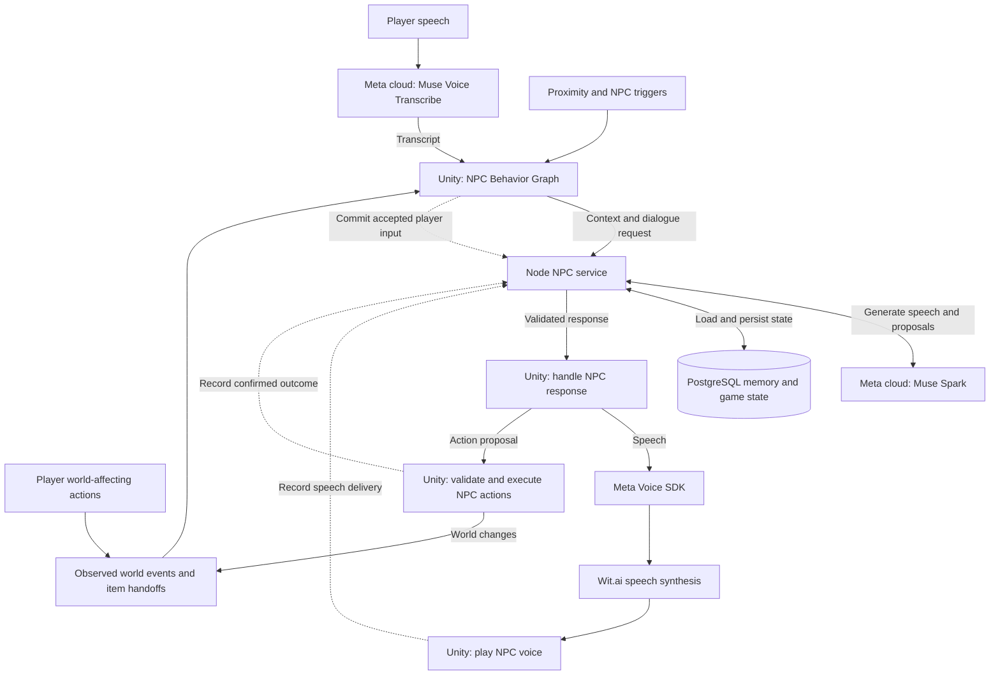

# VillagerAI

VillagerAI is a Unity Quest project for voice-driven interactions with NPCs in a virtual village. Players can talk to characters, build relationships, and take part in quests. Characters respond using their authored personalities, remembered conversations, and events they have observed in the game.

The project combines generated dialogue with authored gameplay. Meta models interpret speech and generate character responses; Unity Behavior Graphs and game code control when characters interact and what actions they can perform. This repository contains the hackathon submission's server and selected Unity integration files.

## Run the web demo (no Unity required)

Talk to Flynn, Sorrel, Mira, and Osric in a browser using their Unity-authored personalities, greetings, and relationship rules. The demo uses the real Meta model and PostgreSQL memory; buttons and text simulate world objects and NPC actions. No Unity installation, headset, or art assets are needed.

### One-line prompt for an LLM coding agent

Copy this into an agent with terminal access to this checkout:

```text
Read README.md and Server/npc-service/demo/README.md, then set up and run the web demo from this checkout assuming no services are running: check Node 22+ and Docker/Compose, create .env from .env.example with random local token and database password while preserving any existing configuration and data, have me enter any missing MODEL_API_KEY privately in .env (never in chat or logs), install dependencies with npm ci, start PostgreSQL and this checkout's NPC service on 127.0.0.1:8787 and demo on 127.0.0.1:8788, verify both health endpoints, open the browser to http://127.0.0.1:8788, confirm a real model reply there, and report setup blockers; if ports are occupied, report the conflict instead of reusing or stopping unrelated services.
```

### Manual quick start

These steps start the full stack from this checkout; no running NPC service or database is assumed. Ports `54329`, `8787`, and `8788` must be available. If another installation occupies them, resolve that conflict before proceeding.

You need **Node.js 22+**, **Docker Desktop or OrbStack running**, and a **Meta Model API key**. Model requests use your API quota.

1. In `Server/npc-service`, copy `.env.example` to `.env` **only if `.env` does not already exist**. Set `MODEL_API_KEY`, a random `LOCAL_ACCESS_TOKEN`, and a URL-safe `POSTGRES_PASSWORD` with the same password in `DATABASE_URL`. Keep `AUTH_MODE=local`, `HOST=127.0.0.1`, and `PORT=8787`. Keep existing credentials and database settings when reusing an installation. No Meta app ID, app secret, or Unity settings file is required for this demo.
2. From the repository root, start the database and NPC service:

   ```sh
   cd Server/npc-service
   docker compose up -d --wait postgres
   npm ci
   npm start
   ```

3. Leave that terminal running. In a second terminal, from the repository root:

   ```sh
   cd Server/npc-service
   node --env-file=.env demo/server.js
   ```

4. Open **[http://127.0.0.1:8788](http://127.0.0.1:8788)** (use `127.0.0.1`, not `localhost`). Chat with Flynn, choose another villager, or try the available world-action buttons. Eligible NPC proposals and world-event reactions run automatically. Reloading preserves your campaign.

Send a message and confirm a generated character reply to verify the model key; a healthy service or an authored greeting alone does not verify model access. Keep the demo local; its proxy is not intended for public hosting.

See the [service setup guide](Server/npc-service/README.md#local-editor) for platform troubleshooting, subsequent starts, and shutdown commands. The [demo guide](Server/npc-service/demo/README.md) covers scenarios, dictation, and simulation limitations.

## Features

- **Voice conversations:** push-to-talk speech recognition, generated NPC dialogue, spoken replies, and captions.
- **Character-specific behavior:** authored personalities, knowledge, restrictions, voices, and relationship criteria shape each NPC's responses.
- **Persistent memory:** conversation history and confirmed action outcomes carry across interactions and application restarts within a campaign.
- **Evolving relationships:** authored rules apply relationship changes based on dialogue evidence and completed gameplay events.
- **Gameplay interaction driven behavior and memory:** NPCs remember confirmed item handoffs, action outcomes, and quest events, including the village’s wasp-nest and house-fire scenarios, and use that history in later conversations. Unity controls gameplay and reports what happened; the AI can propose available actions for Unity to validate and execute.
- **Proximity-driven interactions:** approaching a character starts an interaction; greetings and reactions can occur without a new player utterance.
- **Separate player campaigns:** authenticated player and campaign scopes keep persistent state separate, with a campaign reset starting a fresh history.
- **Local and hosted operation:** develop with a local Node/PostgreSQL service and Quest USB forwarding, or connect to a hosted service over HTTPS.

Meta's models run in the cloud. Unity captures microphone audio, controls NPC behavior, executes gameplay actions, and plays speech. A separate Node service calls Muse Spark and stores persistent state in PostgreSQL.

## Where each model runs

| Stage | Model or service | Caller | Where processing happens |
| --- | --- | --- | --- |
| Speech recognition | Muse Voice Transcribe, `muse-voice-transcribe-1.0` | Unity on the Quest or in the Editor | Meta cloud; microphone capture and transcript handling happen in Unity |
| Dialogue and proposals | Muse Spark, `muse-spark-1.3` | Node NPC service | Meta cloud; context assembly, validation, and persistence happen on the server |
| Speech synthesis | Wit.ai TTS through Meta Voice SDK | Unity | Wit.ai service; audio playback happens in Unity |

The TTS integration selects voice IDs through `TTSSpeaker`; it does not specify a Muse model ID. Meta Platform user-proof verification is also part of the connection, but it is authentication rather than model inference.



World events and authored NPC triggers can start a turn without player speech.
The Behavior Graph chooses when to react and supplies the event's intent and
observations to the model. NPC action proposals pass through Unity's validation
and execution; their observed effects can trigger further NPC reactions.
Memory commits record accepted input and confirmed outcomes without themselves
requesting another model response. Dotted arrows show persistence requests. Player input is committed before its
dialogue request; the Behavior Graph controls action and speech ordering. Authored greetings can use
configured text without a Muse Spark request.

## A conversation turn

1. **Unity captures speech.** The player holds the talk control. `MetaStreamingSpeechToText` streams 24 kHz PCM audio directly to `wss://api.meta.ai/v1/asr/realtime`. `MetaAsrSession` requests `muse-voice-transcribe-1.0` in push-to-talk mode and receives partial and final transcripts. This audio does not pass through the NPC server.
2. **Unity commits the accepted input.** NPC code associates the final transcript with the current interaction and stores it through the server's memory API before requesting a reply. Obsolete interactions are rejected.
3. **The server requests dialogue.** Unity sends the character profile, permitted observations, authored intent, available action options, and current memory revision to `/v1/responses`. The server loads conversation and relationship context and calls `https://api.meta.ai/v1/responses` with `muse-spark-1.3`.
4. **The server validates the result.** Each model call returns speech, a relationship proposal, and an optional action proposal. The server checks proposed actions against Unity's supplied options and validates relationship evidence against committed input. It applies accepted relationship effects before returning the response. Requests use a strict JSON schema, non-streaming output, and minimal reasoning by default. If an accepted relationship change unlocks an action that was not offered on the first request, Unity may request one reconsideration in the same player turn.
5. **Unity performs the response.** Behavior Graphs and authored data control the interaction. Unity executes accepted gameplay actions and sends speech text to Wit.ai TTS through the Meta Voice SDK. The headset plays the resulting audio; the Node service does not synthesize or play it.
6. **Unity records what happened.** NPC speech attempts and observed action outcomes are committed separately. Speech records retain the full NPC line with a completed, interrupted, or failed audio-delivery status. Nonempty recorded lines remain available to later model requests even when audio failed; the status does not claim that the player heard them. An action proposal is not treated as a completed action. PostgreSQL retains accepted events for future turns.

Graph-initiated greetings and reactions can start at the dialogue-request step without microphone input. They carry an authored intent and an empty player-input field.

## Code map

| Location | Responsibility |
| --- | --- |
| `Assets/_Scripts/NPC/NpcProxyClient.cs` | Unity HTTP transport to the NPC service, local bearer authentication, and Meta Platform user proofs |
| `Assets/_Scripts/NPC/NpcProfile.cs` | Character profile and shared server request/response types |
| `Assets/_Scripts/NPC/NpcMemory.cs` and `NpcGameState.cs` | Unity clients for persistent NPC memory and campaign state |
| `Assets/_Scripts/NPC/` | NPC selection, interaction flow, action execution, speech coordination, and Behavior Graph nodes |
| `Assets/GenAI/MetaASR/` | Direct Unity-to-Meta speech recognition: `MetaStreamingSpeechToText.cs` and `MetaAsrSession.cs` |
| `Assets/GenAI/MetaWitt.AI/WittTTS/Witt_TextToSpeech.cs` | Existing Wit.ai playback adapter in the full Unity project; excluded from this submission |
| [Server/npc-service/src/meta.js](Server/npc-service/src/meta.js) | Muse Spark requests and Meta Platform identity verification |
| [Server/npc-service/src/prompts/interaction.txt](Server/npc-service/src/prompts/interaction.txt) | Shared model instructions; character-specific context comes from Unity |
| [Server/npc-service/src/service.js](Server/npc-service/src/service.js) | API routing, validation, authentication, and response coordination |
| [Server/npc-service/src/memory.js](Server/npc-service/src/memory.js) | PostgreSQL persistence, revisions, writer leases, and event receipts |

## Running the service

For character profiles, graph bindings, relationships, handoffs, actions, and quest authoring, see the [NPC authoring guide](docs/NpcAuthoringGuide.md). Its Unity recipes require the full project and dependencies described under Submission scope.

See the [NPC service README](Server/npc-service/README.md) for Node/PostgreSQL setup, Quest USB development, Meta authentication, AWS deployment, and API contracts.

For local development, Node runs on the development computer and the Quest reaches it through ADB reverse forwarding. For hosted use, Unity connects to an HTTPS service endpoint. In both cases, Muse inference remains in Meta's cloud.

The server's `MODEL_API_KEY` stays on the server. Direct ASR uses a separate Unity-side credential resource (`MetaAsrKey.private`), and Wit.ai TTS uses its own configuration. Meta Platform app credentials and user proofs authenticate access to the NPC server; they are separate from model-request credentials. Credential values are not part of the submission.

## Submission scope

This Git repository contains selected files created during the hackathon, October 26, 2026 at noon through November 4, 2026 at 8 PM Central. It includes the NPC server, selected Unity assets and NPC code, the direct Meta ASR implementation, `ISpeechCaptureStatus`, and selected speech integration tests. The original project is managed in Plastic SCM.

Base GroKit code, existing GenAI base classes and TTS adapters, credentials, and other pre-existing dependencies are excluded. Selected files under `Assets/GenAI` are tracked explicitly; the directory-wide ignore rule still excludes its other contents.

The submission is therefore not a standalone Unity project. The Unity integration depends on GroKit, Meta Platform and Voice SDKs, Unity Behavior, and the full project's scene and package configuration.

## Baseten experiment

The separate `baseten-muse-spark` branch preserves the Muse Spark Open experiment from Plastic cs:108. It adds a selectable Baseten provider and a smoke test. It is not merged into `main`; the model flow above describes `main`. See that branch’s `Server/npc-service/README.md` for provider configuration and its branch-specific behavior.
